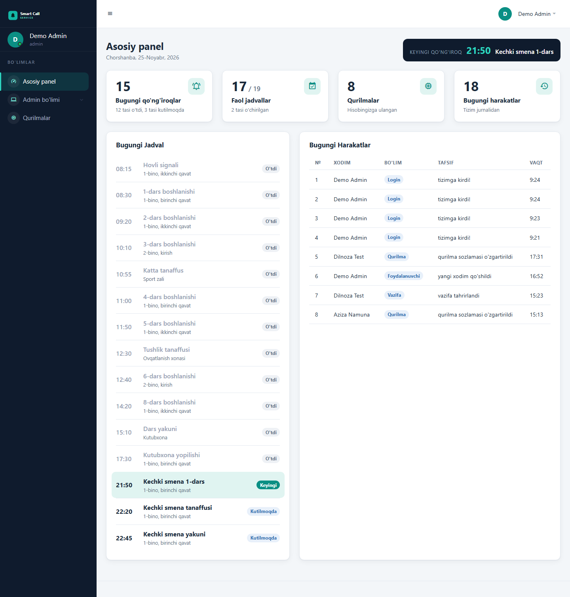
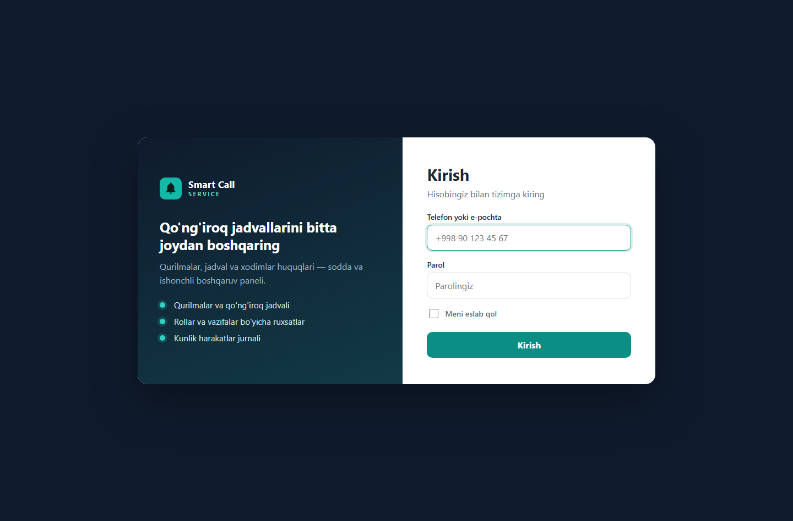
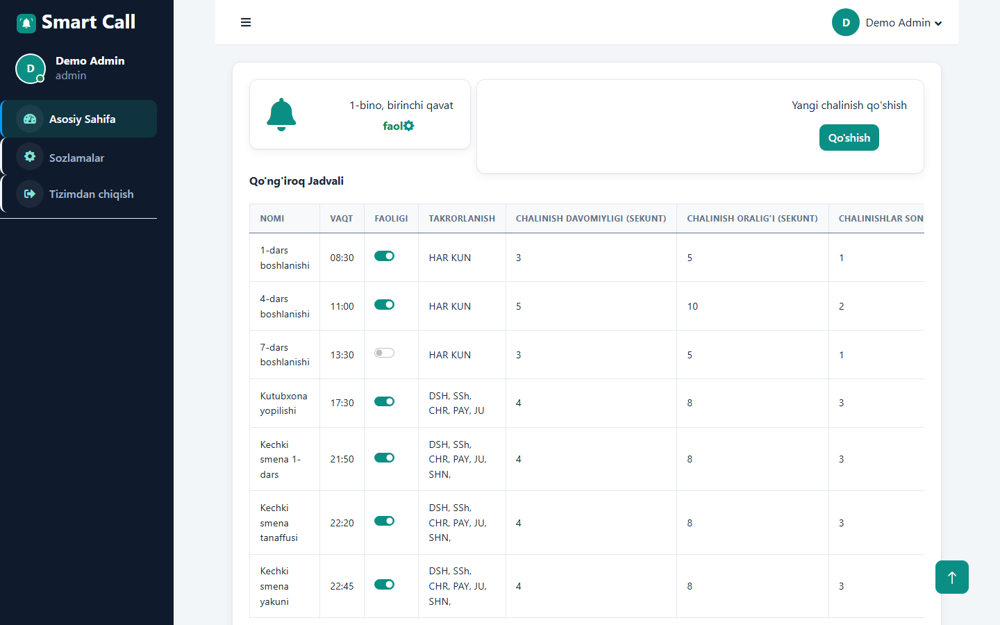
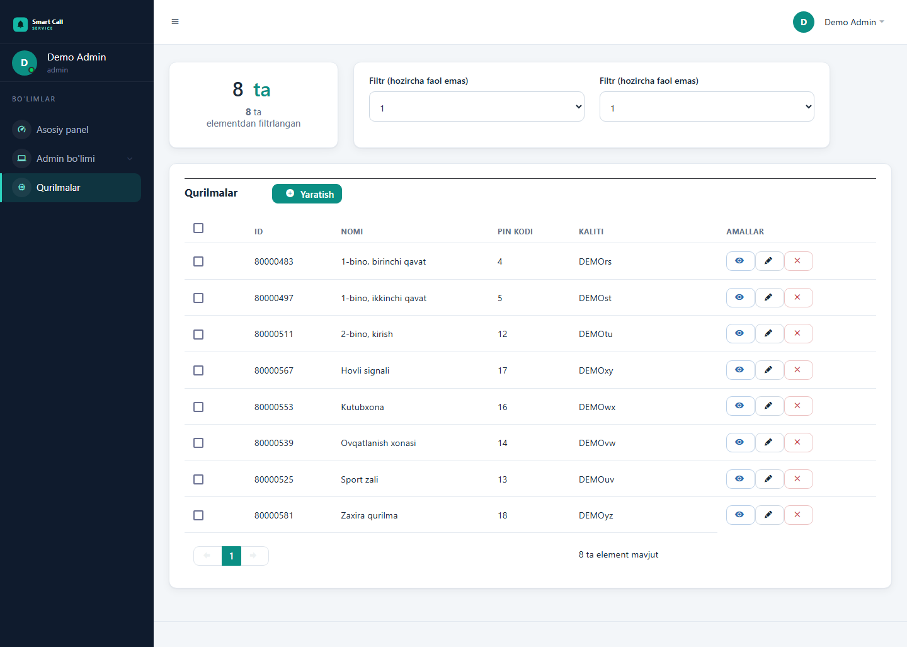
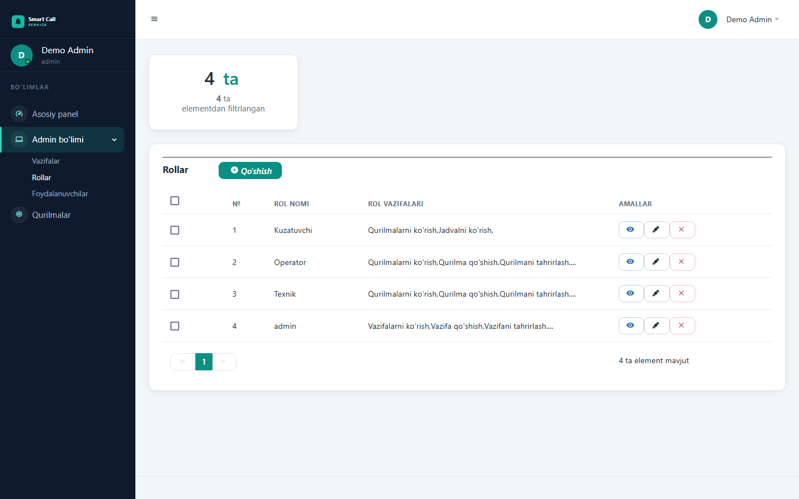
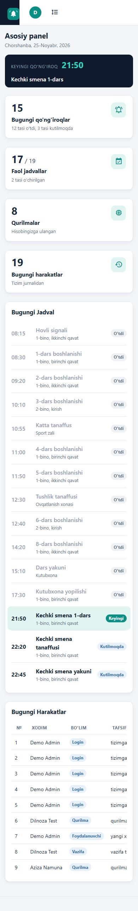
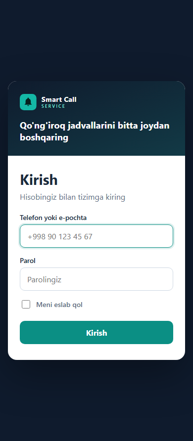
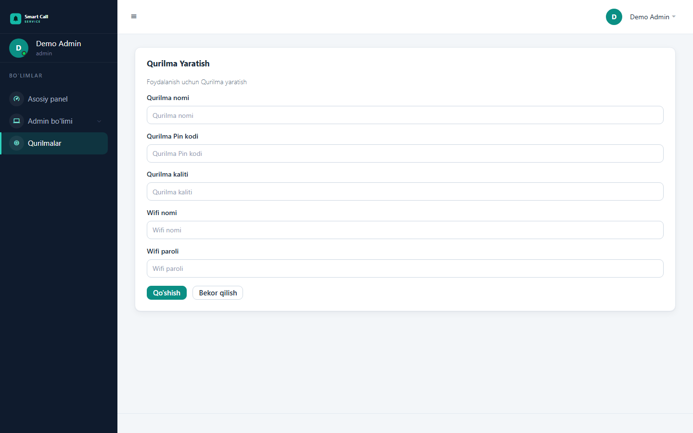
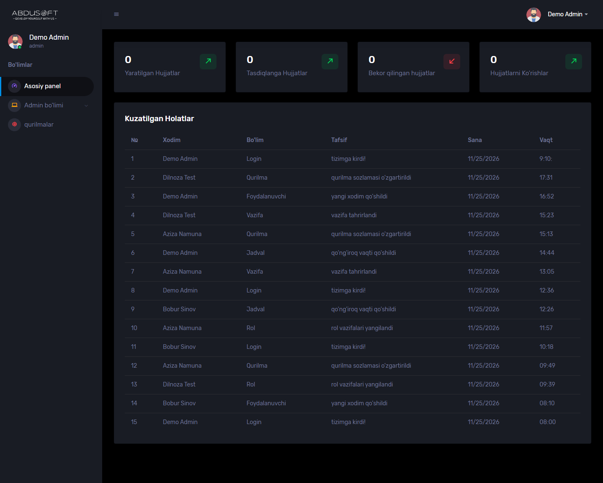

<div align="center">


# Smart Call Service

**Maktab va o'quv markazlari uchun aqlli qo'ng'iroq tizimi: qo'ng'iroq jadvalini veb-paneldan boshqarasiz, qurilma (ESP) uni MQTT orqali oladi va vaqtida chaladi.**


[Ko'rinish](#korinish) · [Qanday ishlaydi](#qanday-ishlaydi) · [O'rnatish](#ornatish) · [Ma'lumot modeli](#malumot-modeli) · [Sahifa](https://abduazizbobomalikovnode.github.io/smart-call-servise/)



</div>

> [!NOTE]
> Barcha screenshotlardagi ismlar, qurilmalar va jadvallar o'ylab topilgan demo ma'lumot. Ular bir martalik MongoDB konteynerida yaratilgan va keyin o'chirilgan.

---

## Ko'rinish

<table>
<tr>
<td width="50%"></td>
<td width="50%"></td>
</tr>
<tr>
<td align="center"><sub>Kirish: telefon yoki e-pochta va parol</sub></td>
<td align="center"><sub>Qurilma jadvali: vaqt, kunlar, davomiylik, oraliq, soni</sub></td>
</tr>
<tr>
<td></td>
<td></td>
</tr>
<tr>
<td align="center"><sub>Qurilmalar: nomi, PIN, broker kaliti</sub></td>
<td align="center"><sub>Rollar: har bir rol qaysi sahifalarga kira oladi</sub></td>
</tr>
</table>

<details>
<summary><b>Telefonda, forma va dizayndan oldingi holat</b></summary>
<br>
<table>
<tr>
<td width="25%"></td>
<td width="25%"></td>
<td width="50%"></td>
</tr>
<tr>
<td align="center"><sub>Telefonda panel</sub></td>
<td align="center"><sub>Telefonda kirish</sub></td>
<td align="center"><sub>Qurilma qo'shish formasi</sub></td>
</tr>
</table>

Panel dastlab ikki xil tayyor shablonda edi: qora "Corona" va "DASHMIN". Dashboard'da esa ilova ma'lumoti emas, shablon namunalari turardi:



Endi barcha sahifalar bitta uslubda (`views/public/assets/css/smartcall.css`). Dashboard bugungi jadval, keyingi qo'ng'iroq va bugungi harakatlarni ko'rsatadi.
</details>

## Qanday ishlaydi

```
Admin / xodim (brauzer)
     │  jadval qo'shadi, o'zgartiradi yoki o'chiradi
     ▼
Express server ──► MongoDB (ring, device, user, role, task, action)
     │
     │  MQTT publish: topic "ring" yoki "seting"
     │  { method, data, date }
     ▼
MQTT broker ──► ESP qurilma (tugma / qo'ng'iroq)
                 jadval bo'yicha chaladi
```

1. Har bir **qurilma** (`device`) ESP plata. Unda PIN raqami, brokerdagi kaliti va Wi-Fi sozlamalari saqlanadi.
2. Har bir **qo'ng'iroq** (`ring`) qurilmaga bog'langan bitta jadval yozuvi. Unda quyidagilar bor:
   - nomi va vaqti (`08:30`);
   - hafta kunlari (1–6, ya'ni dushanbadan shanbagacha);
   - chalinish davomiyligi va oralig'i (soniya) hamda necha marta chalinishi;
   - faol yoki o'chiq holati.
3. Jadval yoki sozlama o'zgarganda server o'zgarishni brokerga yuboradi (`resurs/functions/send_recv_mqtt.js`).
   - Broker manzili bazadagi `mqtt` kolleksiyasidan olinadi.
   - Ulanishda parol o'rniga `JWT_MY_KEY` bilan imzolangan token beriladi.
   - Server `/index/<broker-id>/get` mavzusiga obuna bo'ladi.
4. Har bir muhim amal **harakatlar jurnali**ga (`action`) yoziladi: kim, qaysi bo'limda, nima qildi.

Broker alohida repoda: [broker](https://github.com/AbduazizBobomalikovNode/broker). MQTT sozlanmagan bo'lsa ham panel ishlaydi, faqat qurilmaga xabar ketmaydi.

### Rollar va ruxsatlar

Koddagi `task` xodimga beriladigan vazifa emas, **sahifaga kirish ruxsati**. Masalan: "Qurilmalarni ko'rish", "Vazifa qo'shish". `role_has_task` qaysi rol qaysi ruxsatlarga ega ekanini belgilaydi. Tekshiruvni `middlewire/auth.js` qiladi: so'ralgan yo'l rolning ruxsatlari ichida bo'lishi kerak.

- Rol nomida `admin` bo'lsa, kirgandan keyin **Asosiy panel** (`/`) ochiladi.
- Qolgan foydalanuvchilar **o'z qurilmalari va jadvali** sahifasiga (`/profil`) tushadi.

Kirish telefon raqami yoki e-pochta va parol bilan bo'ladi. Parollar bcrypt bilan saqlanadi, sessiya esa `httpOnly` cookie'dagi JWT (`x-web-token`).

## O'rnatish

Kerak: **Node.js 18+** va **MongoDB**. Qurilmaga xabar yuborish uchun MQTT broker ham kerak, lekin bu ixtiyoriy.

```bash
git clone https://github.com/AbduazizBobomalikovNode/smart-call-servise.git
cd smart-call-servise
npm ci

cp .env.example .env      # qiymatlarni to'ldiring
npm start                 # http://localhost:3000
```

| O'zgaruvchi | Majburiy | Nima uchun |
|---|---|---|
| `URI_MONGO` | ha | MongoDB ulanish satri |
| `JWT_MY_KEY` | ha | Sessiya va MQTT tokenlarini imzolash kaliti. Yangi qiymat: `openssl rand -base64 32` |
| `NODE_ENV` | yo'q | `production` bo'lsa cookie faqat HTTPS orqali yuboriladi |

Port kodda `3000` qilib yozilgan (`index.js`).

## Ma'lumot modeli

| Kolleksiya | Nima saqlaydi |
|---|---|
| `user` | Xodimlar: ism, telefon, e-pochta, parol (bcrypt), rol, broker ID |
| `role` | Rollar |
| `task` | Ruxsatlar (sahifa yo'llari) |
| `role_has_task` | Qaysi rol qaysi ruxsatga ega |
| `device` | Qurilmalar: nomi, PIN, broker kaliti, Wi-Fi |
| `ring` | Qo'ng'iroq jadvali: vaqt, kunlar, davomiylik, oraliq, soni, faolligi |
| `action` | Harakatlar jurnali |
| `mqtt` | Broker manzili |
| `static` | Umumiy sozlamalar |

## Loyiha tuzilishi

```
index.js                       server, routerlar va dashboard statistikasi
routers/                       auth, user, role, task, device, rings, setings
db/mongodb.js, db/tables/      MongoDB ulanishi va kolleksiya funksiyalari
middlewire/auth.js             JWT va rol bo'yicha ruxsat tekshiruvi
resurs/functions/              MQTT, sana formati, xatolar
resurs/validate/               kiruvchi ma'lumot tekshiruvi (Joi)
views/public/                  Pug sahifalar va shablon assetlari
  assets/css/smartcall.css     yagona dizayn qatlami (barcha sahifalar uchun)
  assets/images/smartcall-*    logotip va favicon
docs/                          GitHub Pages sahifasi va README rasmlari
```

## Cheklovlar

- `socket.io`, `docxtemplater` va `qrcode` `package.json` da bor, lekin kodda ishlatilmaydi. DOCX hisobot moduli (`middlewire/document.js`) ulanmagan.
- `/profil` sahifasida shablondan qolgan ikki JS xatosi bor (Tempus Dominus va `waypoint`). Sahifa ishlashiga ta'sir qilmaydi.
- Avtomatik testlar yo'q.
- `views/public/assets/images` da shablondan qolgan va hech qayerda ishlatilmaydigan ~150 ta demo rasm bor.

## Bog'liq loyihalar

- [broker](https://github.com/AbduazizBobomalikovNode/broker): qurilmalar ulanadigan MQTT broker va uning paneli.
- [System-smart-call-v2](https://github.com/AbduazizBobomalikovNode/System-smart-call-v2): soddalashtirilgan ikkinchi versiya.

## Muallif

**Bobomalikov Abduaziz** — [@AbduazizBobomalikovNode](https://github.com/AbduazizBobomalikovNode). Diplom ishi doirasida yozilgan.

Texnologiyalar: Node.js · Express · Pug · MongoDB · MQTT · JWT · bcrypt · Joi
